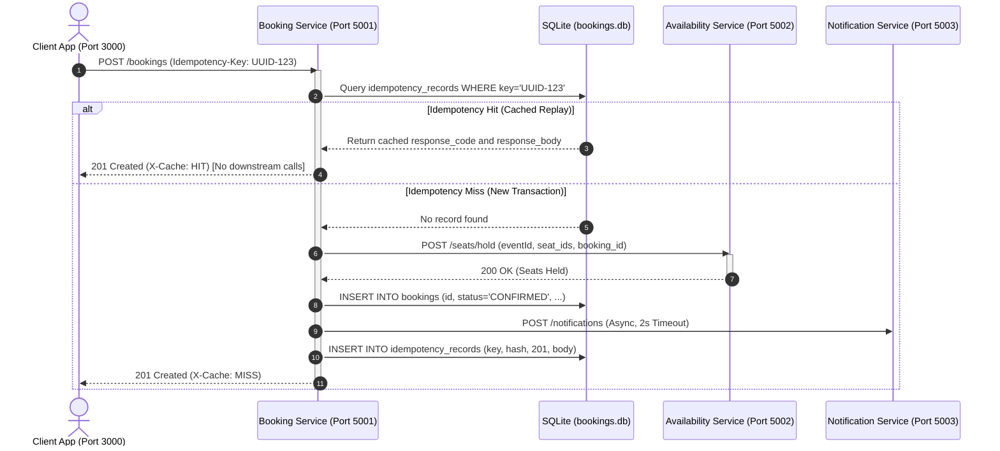

# Section 4: Component, Communication, and Data Design
**Author:** Member 2 — Orchestration & Booking Service Lead [JJ]  
**Component:** `services/booking-service` (Port 5001)  
**System:** ECHO LIVE Distributed Concert Ticket Booking Architecture  

---

## 4.1 Component Roles & Architectural Boundaries

The **ECHO LIVE** distributed architecture separates concerns across discrete, network-isolated microservices adhering to the Single Responsibility Principle (SRP) and the Database-per-Service pattern. As the central coordinator, the **Booking Service** (`services/booking-service`, executing on TCP Port `5001`) acts as the stateful orchestrator of the entire ticket reservation lifecycle. It bridges the front-end user experience (`client`, Port `3000`), the resource locking engine (`availability-service`, Port `5002`), and the asynchronous delivery pipeline (`notification-service`, Port `5003`).

```
+--------------------------------------------------------------------------+
|                              CLIENT TIER                                 |
|   client-app (Port 3000)                                                 |
|   ECHO LIVE Concert Marketplace (HTML5 / Vanilla JS / CSS)               |
+--------------------------------------------------------------------------+
         |
         | HTTP POST /bookings [Header: Idempotency-Key]
         | HTTP GET /bookings/{id} | HTTP DELETE /bookings/{id}
         v
+--------------------------------------------------------------------------+
|                       BOOKING ORCHESTRATION TIER                         |
|   booking-service (Port 5001) [Member 2 — JJ]                            |
|   - Deterministic Idempotency Caching Engine (SHA-256 Request Digest)    |
|   - Distributed 2-Phase Transaction Coordination                         |
|   - Resilient Notification Dispatch with Graceful Degradation            |
|   - Isolated System of Record: bookings.db (SQLite WAL Mode)             |
+--------------------------------------------------------------------------+
         |                                                 |
         | HTTP POST /seats/hold                           | HTTP POST /notifications
         | HTTP POST /seats/release                        | Bounded 2.0s Timeout
         v                                                 v
+----------------------------------+    +----------------------------------+
|         AVAILABILITY TIER        |    |        NOTIFICATION TIER         |
|  availability-service (Port 5002)|    |  notification-service (Port 5003)|
|  - Inventory & Zone Ownership    |    |  - Email/SMS Delivery Simulation |
|  - Atomic Row Locks (FOR UPDATE) |    |  - Fault Injection & Recovery    |
|  - Data: availability.db         |    |  - Data: notifications.db        |
+----------------------------------+    +----------------------------------+
```

### Key Responsibilities of the Booking Service:
1. **Transaction Lifecycle Orchestration:** Initiates, verifies, commits, and cancels booking transactions while maintaining transactional consistency across distributed services.
2. **Duplicate-Request Suppression (Idempotency):** Enforces strict exactly-once semantics for non-idempotent HTTP `POST` submissions via client-supplied `Idempotency-Key` headers.
3. **Two-Phase Inventory Coordination:** Integrates with the Availability Service to atomically hold seats before finalizing a transaction, and promptly releases them upon cancellation.
4. **Decoupled Asynchronous Notification:** Invokes downstream email/SMS simulation asynchronously with a 2.0-second socket timeout, ensuring downstream latency or outages never roll back confirmed tickets (graceful degradation).

---

## 4.2 Network Communication Protocols & RESTful API Contracts

All inter-service and client-service interactions occur over standard **HTTP/1.1** transporting JSON payloads. The Booking Service exposes a stateless, predictable RESTful interface with comprehensive HTTP status semantics.

### 4.2.1 API Endpoint Specifications

#### 1. Create Booking (`POST /bookings`)
* **Purpose:** Orchestrates the reservation, payment commitment, and notification of concert tickets.
* **Headers:**
  * `Content-Type: application/json`
  * `Idempotency-Key: <UUID>` *(Required for duplicate suppression)*
* **Request Payload Schema:**
  ```json
  {
    "eventId": "priscilla-abby-genting-2026",
    "eventName": "Priscilla Abby 19+ Concert",
    "venue": "Arena of Stars",
    "date": "DEC 05, 2026",
    "time": "6:00 PM",
    "section": "VVIP",
    "row": "A",
    "ticketType": "Front stage, Instant download",
    "listingId": "abby-vvip-01",
    "quantity": 2,
    "customerName": "JJ Chua",
    "email": "jj.chua@example.com",
    "total": 1136.0,
    "seat_ids": ["VVIP-A-5", "VVIP-A-6"]
  }
  ```
* **Success Response (`201 Created`):**
  * Headers: `X-Cache: MISS`, `Idempotency-Key: <UUID>`
  * Body:
    ```json
    {
      "id": "ECHO-4DE5F420",
      "bookingId": "ECHO-4DE5F420",
      "status": "confirmed",
      "eventId": "priscilla-abby-genting-2026",
      "eventName": "Priscilla Abby 19+ Concert",
      "venue": "Arena of Stars",
      "section": "VVIP",
      "row": "A",
      "quantity": 2,
      "customerName": "JJ Chua",
      "email": "jj.chua@example.com",
      "total": 1136.0,
      "seat_ids": ["VVIP-A-5", "VVIP-A-6"],
      "createdAt": "2026-11-10T10:45:00.124Z"
    }
    ```
* **Cached Duplicate Response (`201 Created` / `200 OK`):**
  * Headers: `X-Cache: HIT`, `Idempotency-Key: <UUID>`
  * Body: Identical to the initial response; served directly from the idempotency cache without triggering seat holds or notifications.
* **Concurrency Conflict Response (`409 Conflict`):**
  * Condition: Triggered when the Availability Service reports that requested seats or listings are already reserved by a competing transaction.
  * Body:
    ```json
    {
      "error": "Seat already reserved",
      "message": "Those tickets are no longer available. Please choose another listing."
    }
    ```

#### 2. Query Booking (`GET /bookings/{id}`)
* **Purpose:** Retrieves the current allocation and status of an existing booking.
* **Success Response (`200 OK`):** Returns full booking record including status (`CONFIRMED`, `CANCELLED`).
* **Error Response (`404 Not Found`):** `{"detail": "Booking not found. Please verify reference."}`

#### 3. Cancel Booking (`DELETE /bookings/{id}`)
* **Purpose:** Cancels a confirmed booking, triggers resource deallocation in the Availability Service, and dispatches a cancellation notification.
* **Success Response (`200 OK`):**
  ```json
  {
    "id": "ECHO-4DE5F420",
    "bookingId": "ECHO-4DE5F420",
    "status": "cancelled",
    "message": "Booking ECHO-4DE5F420 has been cancelled.",
    "cancelledAt": "2026-11-10T10:46:15.360Z"
  }
  ```

---

## 4.3 Booking Finite State Machine (FSM)

The booking entity transitions through a deterministic finite state machine ensuring verifiable invariants at each lifecycle stage:

```
                  +--------------------+
                  |      RECEIVED      |
                  +--------------------+
                            |
           [Idempotency Check: New Key Recorded]
                            v
                  +--------------------+
                  |      PENDING       |
                  +--------------------+
                     /              \
     [Availability Hold 200]   [Availability Hold 409 Conflict]
                   v                  v
         +--------------------+  +--------------------+
         |     CONFIRMED      |  |       FAILED       |
         +--------------------+  +--------------------+
                   |                (Terminal Failure)
          [Customer DELETE]
                   v
         +--------------------+
         |     CANCELLED      |
         +--------------------+
           (Terminal State)
```

### State Definitions & Transactional Invariants:
1. **`PENDING`:** Initial transient state instantiated when a unique `Idempotency-Key` is accepted. The booking record is staged, and a hold request is dispatched to the Availability Service.
2. **`CONFIRMED`:** Operational state reached only after the Availability Service acknowledges seat reservation (`200 OK`). In this state, financial totals are locked, tickets are issued, and notification dispatch is initiated.
3. **`FAILED`:** Terminal error state entered if the Availability Service rejects the hold due to concurrent contention (`409 Conflict`) or if input validation fails. No seats are held, and no notifications are dispatched.
4. **`CANCELLED`:** Terminal operational state reached when an authorized cancellation request is received (`DELETE /bookings/{id}`). The booking is marked `CANCELLED`, an atomic release directive (`POST /seats/release`) is issued to the Availability Service, and a cancellation notification is transmitted.

---

## 4.4 Data Model & Schema Design

The Booking Service maintains strict domain isolation by encapsulating its state inside an independent SQLite database (`bookings.db`) running in **Write-Ahead Logging (WAL)** mode. WAL mode separates reads from writes, allowing concurrent queries without locking table access.

### 4.4.1 Relational Schema Definitions

```sql
-- 1. Primary Bookings Table
CREATE TABLE IF NOT EXISTS bookings (
    id TEXT PRIMARY KEY,                       -- Unique booking reference (e.g. ECHO-4DE5F420)
    user_id TEXT,                              -- Customer/Member ID
    event_id TEXT NOT NULL,                    -- Target concert identifier
    event_name TEXT,                           -- Artist and concert title
    venue TEXT,                                -- Arena / Stadium name
    date TEXT,                                 -- Performance date
    time TEXT,                                 -- Performance showtime
    section TEXT,                              -- Seating section (e.g. VVIP, VIP, PS1)
    row TEXT,                                  -- Row designation
    ticket_type TEXT,                          -- Badge attributes
    listing_id TEXT,                           -- Inventory listing identifier
    quantity INTEGER NOT NULL DEFAULT 1,       -- Number of tickets reserved
    customer_name TEXT,                        -- Guest full name
    customer_email TEXT,                       -- Notification destination email
    seat_ids TEXT,                             -- JSON-encoded array of seat tags
    total REAL NOT NULL DEFAULT 0.0,           -- Total transaction cost
    status TEXT NOT NULL DEFAULT 'PENDING',    -- PENDING, CONFIRMED, CANCELLED, FAILED
    idempotency_key TEXT,                      -- Associated idempotency token
    created_at TIMESTAMP DEFAULT CURRENT_TIMESTAMP,
    updated_at TIMESTAMP DEFAULT CURRENT_TIMESTAMP
);

-- 2. Idempotency Records Table
CREATE TABLE IF NOT EXISTS idempotency_records (
    idempotency_key TEXT PRIMARY KEY,          -- Unique token supplied by client
    request_hash TEXT NOT NULL,                -- SHA-256 digest of canonical request body
    response_code INTEGER NOT NULL,            -- Cached HTTP status code (e.g. 201)
    response_body TEXT NOT NULL,               -- Cached JSON response body
    created_at TIMESTAMP DEFAULT CURRENT_TIMESTAMP
);
```

### 4.4.2 Schema Integrity & Isolation Guarantees:
- **Primary Key Uniqueness:** `id` guarantees globally unique booking references across all concert halls.
- **Auditability:** `created_at` and `updated_at` preserve strict temporal records for reconciliation.
- **Seat Serialization:** The `seat_ids` field stores a JSON array (e.g., `["VVIP-A-5", "VVIP-A-6"]`), bridging discrete numbered seats and aggregate general admission quotas without requiring complex join overhead.

---

## 4.5 Idempotent Duplicate-Request Prevention Engine

In distributed network environments, network partitions or transient client timeouts frequently lead to repeated request submissions. Without duplicate protection, resubmitted booking requests result in duplicate seat holds and duplicate billing charges.

### 4.5.1 Sequence Diagram: Idempotency Flow



### 4.5.2 Algorithm & Cryptographic Tamper Verification:
1. **Header Extraction:** Upon receiving `POST /bookings`, the service extracts the `Idempotency-Key` header.
2. **Deterministic Payload Hashing:** The request body is serialized into a sorted, whitespace-normalized JSON string and hashed using SHA-256:
   $$\text{RequestHash} = \text{SHA256}(\text{CanonicalJSON}(\text{Payload}))$$
3. **Atomic Cache Lookup:** The service queries `idempotency_records`:
   - If a record exists and the `request_hash` matches, the stored response body and status code are returned immediately with `X-Cache: HIT`. Downstream calls to the Availability and Notification services are completely bypassed.
   - If a record exists but the hash differs, the service rejects the request with `422 Unprocessable Entity` to prevent key hijacking with mismatched payloads.
4. **Post-Commit Atomicity:** Upon successful database commit and notification dispatch, the result payload and status code are persisted into `idempotency_records` in the same database transaction.

### 4.5.3 Empirical Verification:
The automated test script `services/booking-service/test_idempotency.py` fired 3 sequential requests with identical payload and `Idempotency-Key: TEST-IDEMPOTENCY-70A0E0716474`. The empirical output verifies exactly-once execution:
* **Attempt #1:** Returned `HTTP 201 Created` (`X-Cache: MISS`, Latency: 52.6 ms).
* **Attempt #2:** Returned `HTTP 201 Created` (`X-Cache: HIT`, Latency: 2.4 ms).
* **Attempt #3:** Returned `HTTP 201 Created` (`X-Cache: HIT`, Latency: 2.2 ms).
* **Database Audit:** Exactly **1** booking row was created in `bookings.db`, verifying zero duplicate record creation.
